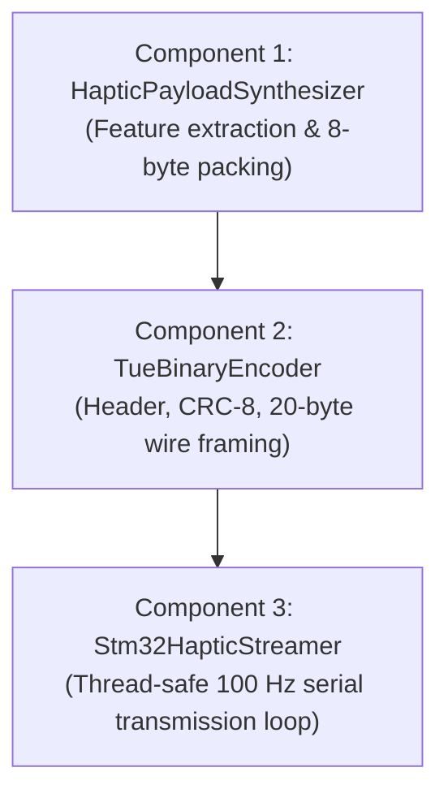

# Host Python Specification: Tactile Haptic Synthesis & Streaming Core

> **Target Workspace**: Python Host Library / Application Repository (`python/tue_usb` or GUI backend)  
> **Environment**: Python 3.9+  
> **Reference Documents**: [`USB_PROTOCOL.md`](USB_PROTOCOL.md), [`SENSOR_DATA_UART_PROTOCOL.md`](SENSOR_DATA_UART_PROTOCOL.md), [`HAPTIC_SLAVE_FIRMWARE_SPEC.md`](HAPTIC_SLAVE_FIRMWARE_SPEC.md)  
> **Input Interface**: Ingests pre-parsed data from Dual 6-Axis Tactile Sensor COM ports (Left & Right)  
> **Output Interface**: USB CDC (Virtual COM Port) @ **100 Hz** (10 ms period) to STM32 Master  

---

## 1. System Context: Master-Slave Architecture & Physical Design

To implement this module correctly, the agent must understand the overarching teleoperation physical setup and the distinct roles of the **Master System** and **Slave System**.

```
===================================================================================================
                                      TELEOPERATION SYSTEM CONTEXT
===================================================================================================

       [ MASTER SYSTEM (ROBOT GRIPPER) ]                              [ SLAVE SYSTEM (OPERATOR HAPTICS) ]
       
         Left Jaw Sensor      Right Jaw Sensor                           Wearable Pneumatic Sleeve (SUP/Ring)
          (USB COM Port)       (USB COM Port)                                 On Single Operator Finger
        ┌───────────────┐    ┌───────────────┐                               
        │ Chuôi (Base)  │    │ Chuôi (Base)  │                                   Chamber D (Hông Trái)
        │     Giữa      │    │     Giữa      │                                            ▼
        │  Ngọn (Tip)   │    │  Ngọn (Tip)   │                                ┌───────────────────────┐
        └───────┬───────┘    └───────┬───────┘                                │   NGÓN TAY NGƯỜI ĐEO  │
                │ Fz_L               │ Fz_R                                   └───────────────────────┘
                └─────────┬──────────┘                                                    ▲
                          │                                                      Chamber E (Hông Phải)
                          ▼                                                  
                   [ 2x USB Ports ]                                          [ MẶT DƯỚI ĐỆM NGÓN TAY ]
                          │                                                  ┌───────┬───────┬───────┐
                          ▼                                                  │   A   │   B   │   C   │
                ┌──────────────────┐                                         └───────┴───────┴───────┘
                │     HOST PC      │                                           Ngọn    Giữa    Chuôi
                │  (PYTHON CORE)   │                                          (Tip)    (Mid)   (Base)
                └─────────┬────────┘                                                      ▲
                          │                                                               │
                          ▼ (USB CDC @ 1 Mbps, CAN ID 0x300, 20 Bytes)                    │
                ┌──────────────────┐                                                      │
                │  STM32F407 MASTER│ ────────► (Hardware UART @ 250k baud, 20 Bytes) ─────┘
                │   (ROBOT PCB)    │                ESP32 WROOM SLAVE CONTROLLER
                └──────────────────┘                 (5x MCP4725 DACs -> 5 Valves)
===================================================================================================
```

### 1.1 Master System Overview (Robotic Gripper)
* **Kinematics**: 2-finger parallel robotic gripper (Left Jaw and Right Jaw).
* **Sensor Instrumentation**: Each jaw is equipped with an advanced 6-axis tactile sensor array.
  * **Physical Mounting Orientation**: The gripper fingers point **vertically downward** toward the workspace (Ngọn/Tip pointing down, Chuôi/Base pointing up).
  * **Sensed Modalities per Jaw**:
    * 3-Axis Resultant Forces: $F_z$ (Normal clamping force), $F_y$ (Longitudinal shear force along finger length), $F_x$ (Lateral shear force across finger width).
    * Spatial Contact: Center of Pressure ($\text{CoP}_x, \text{CoP}_y$).
    * Distributed Pressure Array: 52 discrete taxel normal forces ($F_{z, 1..52}$) mapped across the sensor pad.
  * **Host Connection**: 2 dedicated USB COM ports connected directly to the Host PC for sensor data acquisition.
* **Master Controller**: STM32F407VET6 board responsible for CoreXY/Z motion and gripper actuation, connected to the Host PC via USB CDC (Virtual COM Port @ 1 Mbps).

---

### 1.2 Slave System Overview & Physical Actuator Design
* **Target User Device**: A wearable soft pneumatic thimble/ring sleeve (SUP/Ring) worn on a **single finger** (e.g., index finger) of the human operator.
* **Slave Controller**: ESP32-WROOM microcontroller connected to the STM32 Master board via hardware UART @ 250,000 baud.
* **Actuation Mechanism**: 5 proportional pneumatic air valves controlled by 5x MCP4725 12-bit DACs (A, B, C, D, E) via a PCA9548A I2C multiplexer.
* **Physical Layout of the 5 Pneumatic Silicone Chambers**:
  1. **2 Lateral Side Chambers (Van D & Van E)**:
     * Located on the **Left side** and **Right side** of the finger.
     * **Tactile Role**: Render the **Bilateral Clamping Forces ($F_{z, L}$ and $F_{z, R}$)** exerted by the two gripper jaws. When the robot clamps an object, chambers D and E inflate to squeeze the operator's finger from both sides, conveying grip firmness and asymmetric contact.
  2. **3 Underside / Palmar Pad Chambers (Van A, Van B, Van C)**:
     * Located along the **underside of the finger pad**, arranged longitudinally from tip to base:
       * **Chamber A (Distal Tip - Ngọn ngón)**: Located under the fingertip. Maps to contact/slip occurring at the **Tip (Ngọn)** of the downward-pointing gripper jaws (Zone 1 of the 52-taxel map).
       * **Chamber B (Medial Mid - Giữa đệm ngón)**: Located under the central finger pad. Maps to contact/slip occurring at the **Center (Giữa)** of the gripper jaws (Zone 2 of the 52-taxel map).
       * **Chamber C (Proximal Base - Chuôi đệm ngón)**: Located near the finger joint. Maps to contact/slip occurring at the **Base (Chuôi)** of the gripper jaws (Zone 3 of the 52-taxel map).
     * **Tactile Role**: Render the **Object Weight / Longitudinal Slipping Force ($\bar{F}_{\text{shear}}$ from $F_y$)**, dynamically steered to chambers A, B, or C according to the contact position ($w_A, w_B, w_C$).

---

### 1.3 Why this Host Python Module Exists
* The Host PC receives raw high-dimensional data (104 discrete taxels + two 6-axis force vectors) from the two sensor USB ports.
* The physical slave thimble only has 5 actuator chambers (A, B, C, D, E), and the bridge link between STM32 and ESP32 operates at 250,000 baud.
* Forwarding raw uncompressed data across the UART would consume **96% of the 250k baud bandwidth**, causing buffer overflows, latency jitter, and CPU overload on the ESP32.
* **Role of this Python Core**: Synthesize the 104-taxel multi-axis dataset into **ONE unified 8-byte payload** that maps directly onto the slave's 5 valves, pack it into a standard **20-byte TUE Binary Protocol frame (CAN ID: `0x300`)**, and stream it via USB CDC to the STM32 at **100 Hz**.

---

## 2. Input & Output Data Contracts

### 2.1 Input Data Contract (From Dual Sensor Ingestion Threads)
The module expects pre-parsed dictionaries or objects from the Left and Right sensor ingestion threads:

| Field Name | Type | Units | Description |
|:---|:---:|:---:|:---|
| `fz` | `float` | $\text{N}$ | Normal force perpendicular to the sensor pad |
| `fy` | `float` | $\text{N}$ | Longitudinal shear force (along finger length, pointing downward) |
| `fx` | `float` | $\text{N}$ | Lateral shear force (across finger width) |
| `cop_x`, `cop_y` | `float` | $\text{mm}$ | 2D Center of Pressure coordinates |
| `taxels_fz` | `List[float]` | $\text{N}$ | Array of 52 discrete taxel normal forces ($F_{z, 1..52}$) |

---

### 2.2 Output Wire Frame Contract (To STM32 USB CDC)
A fixed **20-byte packet** conforming to the TUE Binary Protocol:

| Byte Offset | Field Name | Type | Value / Scaling | Target Slave Actuator / Role |
|:---:|:---|:---:|:---|:---|
| `0` | `SOF1` | `uint8` | `0xAA` | Preamble byte 1 |
| `1` | `SOF2` | `uint8` | `0x55` | Preamble byte 2 |
| `2` | `FRAME_TYPE` | `uint8` | `0x01` | `FRAME_TYPE_REQ` (Host to MCU request) |
| `3..6` | `CAN_ID` | `uint32` | `0x00000300` | 32-bit CAN ID in Little-Endian (`0x00, 0x03, 0x00, 0x00`) |
| `7` | `DLC` | `uint8` | `0x08` | Payload length: strictly 8 bytes |
| `8` | `SEQ` | `uint8` | `0..255` | Rolling packet sequence counter |
| **`9`** | **`Fz_Left`** | `uint8` | $0.1\text{ N}$ / LSB ($0..25.5\text{ N}$) | **Van D (Hông trái ngón)** — Má kẹp trái |
| **`10`** | **`Fz_Right`** | `uint8` | $0.1\text{ N}$ / LSB ($0..25.5\text{ N}$) | **Van E (Hông phải ngón)** — Má kẹp phải |
| **`11`** | **`F_shear_avg`** | `uint8` | $0.1\text{ N}$ / LSB ($0..25.5\text{ N}$) | **Độ lớn lực trượt / trọng lượng tổng** |
| **`12`** | **`Weight_Tip`** ($w_A$) | `uint8` | $0..255$ ($0.0 .. 1.0$) | **Tỉ lệ kích hoạt Van A (Ngọn ngón tay)** |
| **`13`** | **`Weight_Mid`** ($w_B$) | `uint8` | $0..255$ ($0.0 .. 1.0$) | **Tỉ lệ kích hoạt Van B (Giữa đệm ngón)** |
| **`14`** | **`Weight_Base`** ($w_C$)| `uint8` | $0..255$ ($0.0 .. 1.0$) | **Tỉ lệ kích hoạt Van C (Chuôi đệm ngón)** |
| **`15`** | **`Status_Flags`** | `uint8` | Bitmask | Bit 0: Left contact, Bit 1: Right contact, Bit 2: Slip, Bit 3: Tare |
| **`16`** | **`Frame_Counter`** | `uint8` | $0..255$ | Rolling cycle counter for loss detection |
| `17` | `CRC8` | `uint8` | SAE J1850 | Checksum calculated over Bytes `2 .. 16` |
| `18` | `EOF1` | `uint8` | `0x55` | Postamble byte 1 |
| `19` | `EOF2` | `uint8` | `0xAA` | Postamble byte 2 |

---

## 3. Mathematical Synthesis Rules & Algorithms

The implementing agent must implement the following mathematical transformations:

### 3.1 Bilateral Clamping Forces ($F_{z, L}, F_{z, R}$)
Extract normal forces from Left and Right sensors, clamp to $0.0 .. 25.5\text{ N}$, scale by 10, and cast to `uint8`:
$$\text{Byte}[0] = \min(255, \max(0, \text{round}(F_{z, \text{Left}} \times 10.0)))$$
$$\text{Byte}[1] = \min(255, \max(0, \text{round}(F_{z, \text{Right}} \times 10.0)))$$

### 3.2 Average Slip / Weight Force ($\bar{F}_{\text{shear}}$)
Because the gripper fingers point downward toward the ground, gravity and slippage pull along the longitudinal shear vector ($F_y$ by default, or $F_x$ if mounted horizontally):
$$F_{\text{shear}, L} = |F_{y, L}|, \quad F_{\text{shear}, R} = |F_{y, R}|$$
$$\bar{F}_{\text{shear}} = \frac{F_{\text{shear}, L} + F_{\text{shear}, R}}{2.0}$$
$$\text{Byte}[2] = \min(255, \max(0, \text{round}(\bar{F}_{\text{shear}} \times 10.0)))$$

### 3.3 3-Zone Spatial Weighting ($w_A, w_B, w_C$)
The 52 discrete taxels are partitioned into 3 geometric bands along the finger length from tip (pointing down) to base (pointing up):
* **Zone 1: Tip / Ngọn (Taxels 0..15)** $\to$ Van A (Distal thimble pad)
* **Zone 2: Mid / Giữa (Taxels 16..35)** $\to$ Van B (Central thimble pad)
* **Zone 3: Base / Chuôi (Taxels 36..51)** $\to$ Van C (Proximal thimble pad)

For both sensors combined ($\text{Taxel}_i = \text{Taxel}_{L, i} + \text{Taxel}_{R, i}$), compute regional force sums:
$$S_1 = \sum_{i=0}^{15} \text{Taxel}_i, \quad S_2 = \sum_{i=16}^{35} \text{Taxel}_i, \quad S_3 = \sum_{i=36}^{51} \text{Taxel}_i, \quad S_{\text{total}} = S_1 + S_2 + S_3$$

**Normalization Logic**:
* If $S_{\text{total}} > F_{\text{contact\_threshold}}$ (e.g. $0.20\text{ N}$):
  $$w_A = \min\left(255, \text{round}\left(255 \times \frac{S_1}{S_{\text{total}}}\right)\right)$$
  $$w_B = \min\left(255, \text{round}\left(255 \times \frac{S_2}{S_{\text{total}}}\right)\right)$$
  $$w_C = \max(0, 255 - (w_A + w_B))$$
* If $S_{\text{total}} \le F_{\text{contact\_threshold}}$: Set $w_A = 0, w_B = 0, w_C = 0$.

### 3.4 Status Bitmask & Frame Counter
* **Bit 0** (`0x01`): `LEFT_CONTACT` set if $F_{z, L} > F_{\text{thresh}}$.
* **Bit 1** (`0x02`): `RIGHT_CONTACT` set if $F_{z, R} > F_{\text{thresh}}$.
* **Bit 2** (`0x04`): `SLIP_ALERT` set if slip detection active or localized shear ratio $|F_y / F_z| > \mu_s$.
* **Bit 3** (`0x08`): `TARE_ACTIVE` set if baseline tare calibration is applied.
* **Frame Counter**: Increments sequentially $0 \to 255 \to 0$ on every synthesized frame.

---

## 4. CRC-8 SAE J1850 Specification

The checksum must strictly follow [`USB_PROTOCOL.md`](USB_PROTOCOL.md) §4:
* **Polynomial**: `0x1D` ($x^8 + x^4 + x^3 + x^2 + 1$)
* **Initial Value**: `0xFF`
* **XOR Output**: `0xFF`
* **Bit Direction**: MSB First (No reflection)
* **Coverage**: Bytes `2 .. 16` (`FRAME_TYPE` through `Frame_Counter`, total 15 bytes)
* **Test Vector**: `CRC8(b"123456789") == 0x4B`
* *Guideline*: Implement via a precomputed 256-entry lookup table for sub-microsecond execution time in Python.

---

## 5. Implementation Steps for the Agent

Follow this modular implementation structure to build the Python module:



### Step 1: Implement `HapticPayloadSynthesizer`
* **Class Responsibility**: State-free or rolling-counter feature extraction engine.
* **Constructor Arguments**: `shear_axis: str = "Y"`, `contact_thresh: float = 0.20`.
* **Primary Method**:
  ```python
  def synthesize(left_data: dict, right_data: dict, slip_alert: bool = False, tare_active: bool = False) -> bytes:
      # Returns exactly 8 bytes (struct.pack("BBBBBBBB", ...))
  ```
* Handle edge cases: missing dictionary keys (use `.get(key, 0.0)`), empty taxel arrays (pad with zeros).

### Step 2: Implement `TueBinaryEncoder`
* **Class Responsibility**: Protocol envelope assembly and CRC computation.
* **Class Constants**: `SOF1 = 0xAA`, `SOF2 = 0x55`, `EOF1 = 0x55`, `EOF2 = 0xAA`, `FRAME_TYPE = 0x01`, `CAN_ID = 0x00000300`, `DLC = 0x08`.
* **Primary Method**:
  ```python
  def encode(payload: bytes) -> bytes:
      # Validates len(payload) == 8
      # Packs Little-Endian Header: struct.pack("<BI2B", FRAME_TYPE, CAN_ID, DLC, seq)
      # Computes SAE J1850 CRC-8 over header + payload
      # Returns exact 20 bytes
  ```

### Step 3: Implement `Stm32HapticStreamer` (Threaded Worker)
* **Class Responsibility**: Manages background transmission at regulated 100 Hz without blocking the main GUI/sensor acquisition loop.
* **Inheritance**: Subclass of `threading.Thread(daemon=True)`.
* **State Management**:
  * Use a `threading.Lock()` to protect access to `left_data` and `right_data` snapshots.
  * Provide a thread-safe method `update_sensors(left_data, right_data, slip_alert=False)`.
* **Loop Regulation**:
  * In `run()`: Calculate elapsed loop time using `time.perf_counter()`.
  * Regulate sleep interval: `sleep_time = 0.010 - (time.perf_counter() - t0)`.
  * If `sleep_time > 0`: `time.sleep(sleep_time)`.
* **Serial Port Management**:
  * Open serial connection: `serial.Serial(port, baudrate=1000000, timeout=0.05)`.
  * Provide clean `open()` and `close()` lifecycle methods with thread termination join.

---

## 6. Robustness & Edge Case Handling

1. **Sensor Disconnection**: If a sensor stops reporting data or disconnects, the synthesizer must detect stale data (e.g. timestamp $> 100\text{ ms}$ old) and clamp that sensor's force contributions to zero.
2. **Serial Write Protection**: Wrap `ser.write()` in a `try...except serial.SerialException` block to catch USB unplug events cleanly and log warnings without crashing the main application thread.
3. **Array Dimension Invariant**: Always enforce that taxel arrays contain 52 elements before slicing into zones. Pad with `0.0` if shorter, or slice `[:52]` if longer.

---

## 7. Verification & Acceptance Criteria

The implementing agent must verify the implementation against the following test benchmarks:

### Test Case 1: Self-Test Vectors

| Test Case | Left Sensor Input | Right Sensor Input | Expected 8-Byte Payload (Hex) | Expected 20-Byte Frame |
|:---|:---|:---|:---|:---|
| **Zero / Idle** | All forces = $0.0\text{ N}$ | All forces = $0.0\text{ N}$ | `00 00 00 00 00 00 00 [seq]` | CRC valid, Postamble `55 AA` |
| **Pinch Only** | $F_z = 5.0\text{ N}$, $F_y = 0.0$ | $F_z = 3.0\text{ N}$, $F_y = 0.0$ | `32 1E 00 00 00 00 03 [seq]` | $F_{z, L} = 50$, $F_{z, R} = 30$, flags = `0x03` |
| **Shear at Tip**| $F_z = 2.0\text{ N}, F_y = 1.0\text{ N}$, Taxels $0..15 = 1.0\text{ N}$ | Same as Left | `14 14 0A FF 00 00 03 [seq]` | $F_{\text{shear}} = 10$, $w_A = 255$, $w_B = 0, w_C = 0$ |

### Test Case 2: Transmission Rate Validation
* Measure consecutive packet timestamps with a hardware USB analyzer or serial loopback script:
  * Mean interval: **$10.0\text{ ms} \pm 0.5\text{ ms}$** ($100\text{ Hz}$).
  * Frame length: **Exactly 20 bytes** every burst.

---

## 8. Host Implementation (delivered)

Implemented in `unified_gui/haptic.py` and wired into the unified GUI:

| Spec component | Code |
|:--|:--|
| `HapticPayloadSynthesizer` | `unified_gui.haptic.HapticPayloadSynthesizer` (synthesis rules §3, stale-data guard §6.1) |
| `TueBinaryEncoder` | `unified_gui.haptic.TueBinaryEncoder` (20-byte envelope built with the shared `tue_usb.Frame`, SAE J1850 CRC-8) |
| `Stm32HapticStreamer` | `unified_gui.haptic.Stm32HapticStreamer` (100 Hz regulated writer, thread-safe `update_sensors`, own `serial.Serial`) |

The §7.1 acceptance vectors and the §4 CRC reference vector are asserted in
`tests/test_haptic.py`; frame length is pinned at exactly 20 bytes. The five
valves are visualised live by `unified_gui/valvemap.py`. Select the
"STM32 Haptic Out" role in the Connection panel to start streaming at
1 Mbaud / 100 Hz.

