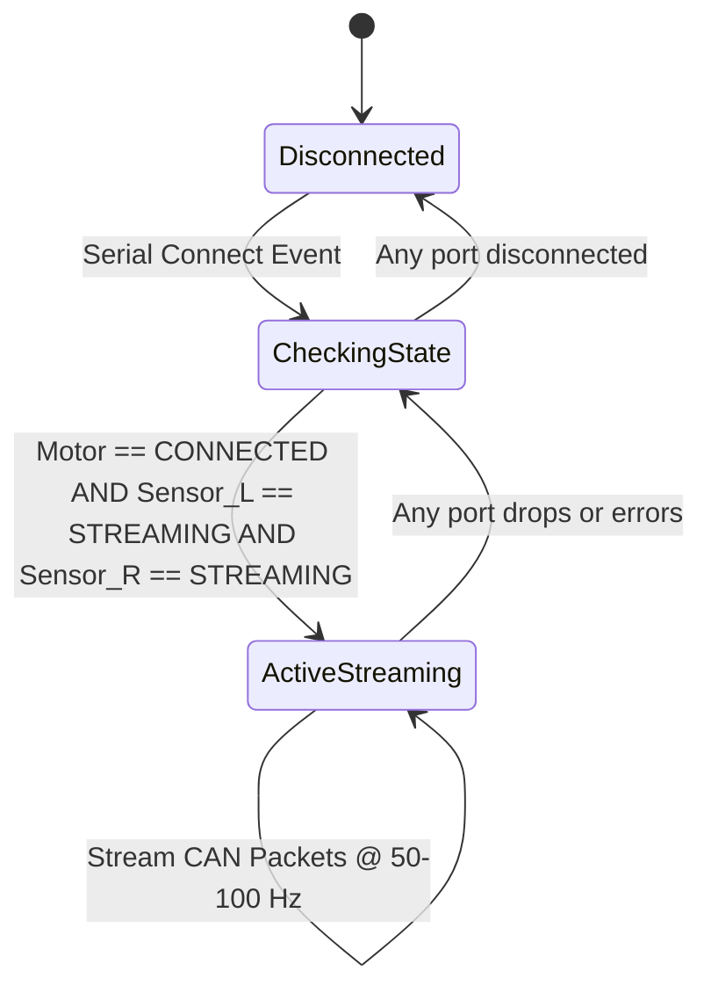

# Action Plan: Stream Tactile Sensor Data via Motor Controller COM Port (Custom CAN Payload)

## 1. Executive Summary & Objective

### 1.1 Goal
Extend the **Unified PyQt6 Haptic System GUI** so that whenever **all three COM ports are connected and active** (Left Tactile Sensor, Right Tactile Sensor, and the STM32F407 Motor Controller), the system automatically starts streaming synchronized tactile sensor data—including **3-axis resultant forces**, **spatial contact position (CoP & Peak Taxel)**, and the **52-taxel distributed pressure map**—through the **motor controller USB COM port** (1,000,000 baud).

### 1.2 Rationale
The STM32F407VET6 motor controller board acts as an embedded data logger / haptic reflex controller. Receiving live tactile feedback from both fingers directly on the PCB enables:
* Synchronized hardware-level timestamping against actual stepper motor step counts and STS3215 servo positions.
* Future firmware-level low-latency grip force reflex loops without PC round-trip latency.

---

## 2. Trigger Logic: Connection State Machine

The data streaming bridge must operate fully autonomously:



### Trigger Condition Specification
In the GUI polling loop (`unified_gui/main_window.py` -> `_on_tick`):
```python
all_connected = (
    self.motor is not None
    and self.motor.snapshot().connected
    and self.links.get("L") is not None
    and self.links["L"].state == "streaming"
    and self.links.get("R") is not None
    and self.links["R"].state == "streaming"
)
```
* **Auto-Start**: When `all_connected` transitions from `False` to `True`, the `SensorCanBridge` starts transmitting.
* **Auto-Pause/Stop**: If any port drops, disconnects, or errors, transmission ceases immediately.
* **Auto-Resume**: When the missing port is reconnected, transmission resumes seamlessly without requiring a GUI restart.

---

## 3. Custom CAN Packet Protocol Specification

The motor controller COM port runs at **1,000,000 baud** (8-N-1). Because the existing link carries ASCII text for motor commands (`<TARGET> <ID> <DIR> <FIELD> [ARGS...] \n`), the sensor CAN packets must use a **distinct binary framing envelope** that the STM32 firmware can parse unambiguously without colliding with ACSI commands.

### 3.1 Binary CAN-over-UART Frame Envelope

Every CAN frame is encapsulated in a lightweight, robust 14-to-18 byte binary packet:

```
+------------+------------+---------------+------------+---------+------------------+------------+------------+
| SOF (2B)   | Frame Type | CAN ID (4B)   | DLC (1B)   | Seq (1B)| Payload (0..8B)  | CRC8 (1B)  | EOF (2B)   |
| 0xAA 0x55  | 1 Byte     | uint32 (LE)   | 0..8       | uint8   | DLC Bytes        | SAE J1850  | 0x55 0xAA  |
+------------+------------+---------------+------------+---------+------------------+------------+------------+
```

* **SOF (Start of Frame)**: `0xAA 0x55` (Distinct from ACSI ASCII text which starts with digits `1..4`).
* **Frame Type**: `0x01` = Standard Classic CAN (8-byte payload), `0x02` = CAN-FD (up to 64 bytes).
* **CAN ID**: Standard 11-bit or 29-bit identifier (Little Endian, uint32).
* **DLC (Data Length Code)**: Number of payload bytes (`0x08` for classic CAN).
* **Seq**: Rolling sequence counter (0–255) for frame loss detection.
* **Payload**: 8 bytes formatted per CAN ID (detailed below).
* **CRC8**: CRC-8-SAE J1850 (polynomial $0x1D$, init $0xFF$) computed over `[Frame Type ... Payload]`.
* **EOF (End of Frame)**: `0x55 0xAA`.

---

### 3.2 CAN ID Allocation Table

Standard 11-bit CAN Identifiers (`0x300` – `0x32F` reserved for Tactile Telemetry):

| CAN ID | Sensor | Description | DLC | Rate |
| :--- | :--- | :--- | :--- | :--- |
| `0x300` | Sync | Master Synchronization & Timestamp Heartbeat | 8 | 100 Hz |
| `0x301` | **Left** | Resultant Force ($F_x, F_y, F_z, |F|$) | 8 | 100 Hz |
| `0x302` | **Left** | Contact Position ($\text{CoP}_x, \text{CoP}_y, \text{Peak Taxel}, \text{Contact Count}$) | 8 | 100 Hz |
| `0x303` | **Right** | Resultant Force ($F_x, F_y, F_z, |F|$) | 8 | 100 Hz |
| `0x304` | **Right** | Contact Position ($\text{CoP}_x, \text{CoP}_y, \text{Peak Taxel}, \text{Contact Count}$) | 8 | 100 Hz |
| `0x310`..`0x316` | **Left** | 52-Taxel Distributed Map Chunks (Chunks 0..6) | 8 | 50 Hz |
| `0x320`..`0x326` | **Right** | 52-Taxel Distributed Map Chunks (Chunks 0..6) | 8 | 50 Hz |

---

### 3.3 Payload Bit-Level Layouts

#### Packet 1: Master Sync & Timestamp (`0x300`)
Carries host synchronized millisecond clock and sensor status flags.
```
Byte 0..3: uint32_t timestamp_ms  - Monotonic milliseconds since system start
Byte 4:    uint8_t  sensor_status - Bit 0: Left streaming, Bit 1: Right streaming, Bit 2: Tare active
Byte 5:    uint8_t  reserved      - 0x00
Byte 6..7: uint16_t frame_index   - Global 16-bit cycle counter
```

#### Packet 2: Resultant Forces (`0x301` for Left, `0x303` for Right)
All forces encoded as 16-bit signed integers in **centi-Newtons ($0.01\text{ N}$ / LSB)**, range $\pm 327.67\text{ N}$.
```
Byte 0..1: int16_t Fx_cN   - Shear force X  (Value = int16(Fx * 100.0))
Byte 2..3: int16_t Fy_cN   - Shear force Y  (Value = int16(Fy * 100.0))
Byte 4..5: int16_t Fz_cN   - Normal force Z (Value = int16(Fz * 100.0))
Byte 6..7: uint16_t Fmag_cN - Total magnitude |F| (Value = uint16(F_mag * 100.0))
```

#### Packet 3: Contact Position & CoP (`0x302` for Left, `0x304` for Right)
Coordinates in **centi-millimeters ($0.01\text{ mm}$ / LSB)**, range $\pm 327.67\text{ mm}$.
```
Byte 0..1: int16_t CoP_x_cmm - Center of Pressure X coordinate (Value = int16(CoP_x * 100.0))
Byte 2..3: int16_t CoP_y_cmm - Center of Pressure Y coordinate (Value = int16(CoP_y * 100.0))
Byte 4:    uint8_t peak_taxel - Index of peak normal force taxel (1..52, or 0 if no contact)
Byte 5:    uint8_t contact_n  - Number of taxels in contact (0..52)
Byte 6..7: int16_t tilt_cdeg  - Force vector tilt angle (Value = int16(tilt_deg * 10.0), 0.1 deg/LSB)
```
*(Note: If CoP is invalid/NaN due to no contact, `CoP_x_cmm` and `CoP_y_cmm` are set to `0x7FFF`).*

#### Packet 4: Distributed Taxel Map Chunks (`0x310..0x316` Left, `0x320..0x326` Right)
The 52 normal forces $F_{z, 1..52}$ are packed into 7 consecutive CAN frames (8 bytes per frame = 56 slots; the last 4 bytes of chunk 6 are padded with `0x00`).
Each taxel normal force is encoded as **1 byte unsigned ($0.1\text{ N/LSB}$)** matching the native PaXini sensor hardware resolution ($0..25.5\text{ N}$):

* **Chunk 0 (`0x310` / `0x320`)**: Taxels 1 through 8
* **Chunk 1 (`0x311` / `0x321`)**: Taxels 9 through 16
* **Chunk 2 (`0x312` / `0x322`)**: Taxels 17 through 24
* **Chunk 3 (`0x313` / `0x323`)**: Taxels 25 through 32
* **Chunk 4 (`0x314` / `0x324`)**: Taxels 33 through 40
* **Chunk 5 (`0x315` / `0x325`)**: Taxels 41 through 48
* **Chunk 6 (`0x316` / `0x326`)**: Taxels 49 through 52 + 4 bytes padding (`0x00`)

*(Optional CAN-FD Mode: If the STM32 firmware is configured for CAN-FD, a single 64-byte payload packet with CAN ID `0x330` for Left and `0x331` for Right delivers all 52 taxels in one shot).*

---

### 3.4 Bandwidth & Timing Verification

* At 100 Hz resultant rate + 50 Hz taxel map rate:
  * Resultant + CoP packets: 4 packets $\times 16\text{ bytes} \times 100\text{ Hz} = 6,400\text{ B/s}$
  * Taxel map packets: 14 packets $\times 16\text{ bytes} \times 50\text{ Hz} = 11,200\text{ B/s}$
  * Sync heartbeat: 1 packet $\times 16\text{ bytes} \times 100\text{ Hz} = 1,600\text{ B/s}$
  * **Total bandwidth:** $\approx 19.2\text{ kB/s} = 192,000\text{ bps}$.
* Serial baud rate: **1,000,000 bps**.
* **Bus utilization:** $< 20\%$, leaving $> 80\%$ channel capacity for motor motion commands (`step_jog`, `step_move`, telemetry polling).

---

## 4. Software Implementation Roadmap (Actions Instruction)

Follow these modular steps to implement the feature without regressing existing GUI functionality.

### Step 4.1: Create `unified_gui/can_bridge.py`
Create a dedicated bridge module containing:
1. `class CanPacketBuilder`: Helper methods to pack resultant force, CoP position, and taxel map arrays into byte arrays with CRC-8 and framing bytes (`0xAA 0x55 ... 0x55 0xAA`).
2. `class SensorCanBridge(threading.Thread)`:
   * Thread-safe worker running at 100 Hz.
   * Reads snapshots from `SensorLink.reading()` for both Left and Right sensors.
   * Assembles packets and writes binary chunks directly to the motor controller serial stream via a thread-safe callback.
   * Includes rate statistics and frame counters.

### Step 4.2: Expose Raw Binary Serial Write in `unified_gui/motor.py`
In `MotorWorker`:
* Add a thread-safe method `write_raw(self, data: bytes) -> None` that sends urgent or telemetry bytes directly through `self._client._ser.write(data)` protected by `self._lock` or dedicated serial write lock.

### Step 4.3: Integrate Connection Trigger in `unified_gui/main_window.py`
In `MainWindow`:
* Instantiate `self.can_bridge = SensorCanBridge(self._write_motor_raw, log=self.post_log)`.
* In `_on_tick(self)`:
  ```python
  all_ready = (
      self.motor is not None
      and self.motor.snapshot().connected
      and self.links.get("L") is not None
      and self.links["L"].state == "streaming"
      and self.links.get("R") is not None
      and self.links["R"].state == "streaming"
  )
  if all_ready and not self.can_bridge.is_active:
      self.can_bridge.start_streaming(self.links["L"], self.links["R"])
      self.post_log("[Bridge] All 3 ports active: streaming tactile CAN packets to motor COM")
  elif not all_ready and self.can_bridge.is_active:
      self.can_bridge.stop_streaming()
      self.post_log("[Bridge] Port disconnected: paused tactile CAN streaming")
  ```
* On GUI shutdown (`closeEvent`), ensure `self.can_bridge.stop()` is cleanly joined.

### Step 4.4: Add UI Indicator in `unified_gui/panels/connection.py`
* Add a small LED status dot and label in the Connection Panel:
  * `CAN Stream: INACTIVE` (Gray)
  * `CAN Stream: STREAMING 100Hz` (Bright Green)

---

## 5. Firmware (STM32F407) Implementation Reference

For the firmware engineer flashing the STM32F407 motor controller PCB:

### 5.1 C Data Structures
```c
#pragma pack(push, 1)

typedef struct {
    int16_t fx_cN;      // 0.01 N
    int16_t fy_cN;      // 0.01 N
    int16_t fz_cN;      // 0.01 N
    uint16_t f_mag_cN;  // 0.01 N
} CanPayload_Force_t;

typedef struct {
    int16_t cop_x_cmm;   // 0.01 mm (0x7FFF = Invalid/No contact)
    int16_t cop_y_cmm;   // 0.01 mm (0x7FFF = Invalid/No contact)
    uint8_t peak_taxel;  // 1..52 (0 = none)
    uint8_t contact_n;   // 0..52
    int16_t tilt_cdeg;   // 0.1 deg
} CanPayload_Position_t;

typedef struct {
    uint8_t taxel_fz[8]; // 0.1 N per LSB
} CanPayload_TaxelChunk_t;

#pragma pack(pop)
```

### 5.2 UART/USB RX Stream Parser (State Machine)
Implement in the USB VCP receive interrupt / thread:
* If byte is ASCII (e.g. `'1'..'4'`), route to existing ACSI command parser.
* If header matches `0xAA 0x55`, route to binary CAN frame unpacker:
  1. Validate length and CRC-8.
  2. Switch on `CAN_ID`:
     * `0x301` / `0x303`: Store Left/Right Resultant Force.
     * `0x302` / `0x304`: Store Left/Right Contact Position (CoP).
     * `0x310..0x316` / `0x320..0x326`: Assemble 52-taxel pressure array.
  3. Write synchronized record (Timestamp + Stepper Position + Gripper Pos + Sensor Data) into onboard DMA ring buffer for Flash/SD card write.

---

## 6. Verification and Validation Checklist

Before releasing the updated GUI:
- [ ] **Handshake Test**: Connect Motor only. Verify motor commands and jog buttons operate normally.
- [ ] **Dual Sensor Test**: Connect Sensor L and Sensor R. Verify 2D plots and 3D point cloud update normally.
- [ ] **Trigger Activation Test**: Connect Motor + Sensor L + Sensor R simultaneously. Verify the CAN bridge begins transmitting immediately without drops.
- [ ] **Disconnection Resilience Test**: Unplug Sensor L while streaming. Verify CAN bridge stops cleanly and motor remains controllable without serial buffer lockup.
- [ ] **Reconnection Test**: Replug Sensor L and reconnect. Verify CAN bridge resumes streaming automatically.
- [ ] **Throughput Test**: Monitor serial loopback with a virtual COM or logic analyzer; verify packet frequency is steady at 100 Hz and CRC-8 check passes 100%.
